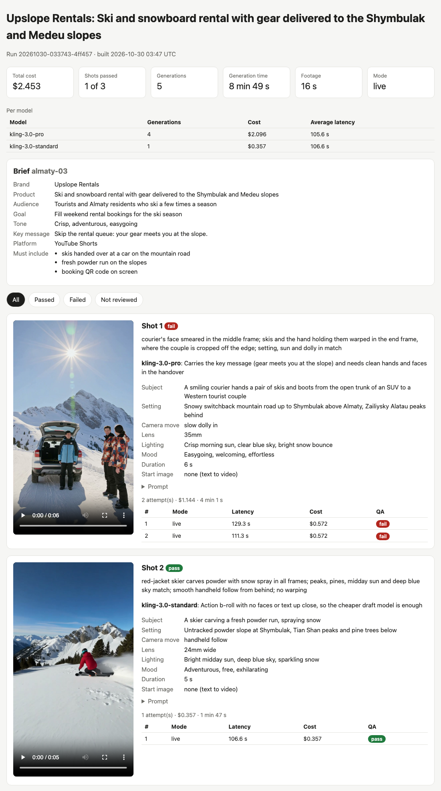
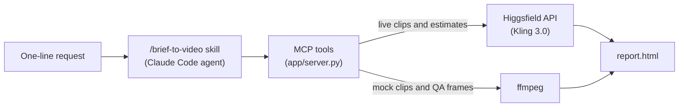

# brief-to-video-agent

[](https://github.com/apazylbekov/brief-to-video-agent/actions/workflows/ci.yml)

Type one line, get a reviewed video plan and the clips. `./run.sh "Almaty trailer for Westerners"`
has a Claude Code agent pick the best-matching creative brief, write a three-shot list in camera
language, generate each shot with Higgsfield's Kling 3.0 models, check frames from every clip
against a QA rubric (regenerating a failed shot once), and publish an HTML report with cost,
latency and pass rate per model. A small MCP server keeps the agent honest. It validates every
plan, prices every clip with Higgsfield's estimate endpoint before paying for it, refuses anything
over the spend cap, and logs each step. Mock mode runs the whole pipeline for $0 on video; one
live run of five clips cost $2.45 on Higgsfield plus $0.83 of Claude.



**Recording:** _coming soon_ <!-- placeholder: replace with the walkthrough link once uploaded -->

## How it works



The skill (`.claude/skills/brief-to-video/SKILL.md`) is the workflow; the MCP server
(`app/server.py`, registered in `.mcp.json`) owns everything that must not depend on the model
behaving: validation, pricing, the spend cap, files and logs. Brief search uses Gemini embeddings
when `GEMINI_API_KEY` is set, and keyword scores otherwise.

## MCP tools

| Tool | What it does | Spends money |
|---|---|---|
| `search_briefs(query, k=3)` | Ranks the 24 briefs in `data/briefs.json` by Gemini embedding similarity, or keyword overlap without a key | No (free-tier embeddings) |
| `save_shot_list(brief_id, shots)` | Validates 3–4 shots (3–8 s each, 20 s total, a known model, a prompt of at most 600 characters), saves `runs/<run_id>/shots.json`, and returns the estimated cost per shot. If anything is wrong, it lists every problem at once | No (estimates only) |
| `generate_clip(run_id, shot_index)` | Prices the clip, refuses it if it would pass `MAX_SPEND_USD`, generates it (Higgsfield live, an ffmpeg test pattern in mock mode) to `runs/<run_id>/shot_<n>.mp4`, and logs it | Yes, in live mode |
| `review_clip(run_id, shot_index)` | Extracts the start, middle and end frames for the agent to judge, with the shot's spec | No |
| `record_review(run_id, shot_index, verdict, reasons)` | Logs the verdict to `runs.csv` and `shots.json`. A shot's first `fail` is regenerated once, within the cap; a second is final | Only when it regenerates |
| `build_report(run_id)` | Writes `runs/<run_id>/report.html` | No |

## Setup

You need [uv](https://docs.astral.sh/uv/), `ffmpeg`/`ffprobe` on your PATH, and
[Claude Code](https://claude.com/claude-code) for the agent.

```bash
uv sync                  # Python 3.12 and dependencies, from uv.lock
cp .env.example .env     # then fill in the keys you have
```

| Variable | Used for | Needed |
|---|---|---|
| `HF_KEY` | Higgsfield, as `key_id:secret` | Live mode only |
| `GEMINI_API_KEY` | Brief search embeddings | Optional (keyword search without it) |
| `VIDEO_MODE` | `mock` (default, $0 video) or `live` | Optional |
| `MAX_SPEND_USD` | Cap on total Higgsfield spend in `runs/runs.csv` (default 8) | Optional |

A non-empty value in your shell beats `.env`, and `.env` beats the defaults.

**Approving the server in Claude Code.** `.mcp.json` registers the server as `brief-to-video` and
passes those four variables through, with no secrets in the file.

- `./run.sh` (headless `claude -p`) loads it without asking.
- In an interactive session, start `claude` in the project root and approve `brief-to-video` when
  asked; `/mcp` shows its status.
- To pre-approve it, add `"enabledMcpjsonServers": ["brief-to-video"]` to your user settings
  (`~/.claude/settings.json`). The same line committed to the project's settings is ignored in a
  folder you haven't trusted, by design.
- Check it from the terminal: `claude mcp list` should show `brief-to-video: … ✔ Connected`.

Claude Code needs `uv` on its own PATH. If you launch it from the desktop app, it may not see
`~/.local/bin`.

## Usage

```bash
./run.sh "Almaty trailer for Westerners"                  # mock: placeholder clips, Claude cost only
VIDEO_MODE=live ./run.sh "Almaty trailer for Westerners"  # real clips, within MAX_SPEND_USD
```

```
Claude: $0.8297 in 624 s (success); output saved to runs/20261030-033743-4ff457/agent.json
Report: /…/brief-to-video-agent/runs/20261030-033743-4ff457/report.html
```

Each run gets a folder `runs/<run_id>/` with `shots.json`, the clips, `frames/`, `report.html` and
Claude's JSON output (`agent.json`). `runs/runs.csv` logs every generation and review, and
`runs/agent_runs.csv` logs Claude's cost and duration per `run.sh` call. Claude's own spend is
capped at $2 per run.

You can also type `/brief-to-video <request>` in an interactive Claude Code session, or generate a
single clip without the agent: `uv run python -m app.smoke "a drone shot of a mountain lake"`.

Development: `uv run pytest` (61 tests, no API keys or network needed), `uv run ruff check .`.
CI runs both on every push.

## Results per model

From the live rows of `runs/runs.csv`, 2026-10-30: one live agent run (five clips) plus one smoke
clip. All clips are 9:16 with sound off.

| Model | Role | Clips | Footage | Cost | Per second | Latency, average (range) | QA pass rate |
|---|---|---|---|---|---|---|---|
| `kling-3.0-standard` | draft | 2 | 10 s | $0.714 | $0.0714 | 96.2 s (85.7–106.6) | 1 of 1 |
| `kling-3.0-pro` | quality | 4 | 22 s | $2.096 | $0.0953 | 105.6 s (86.0–129.3) | 0 of 4 |
| **Total** | | **6** | **32 s** | **$2.810** | | | **1 of 5** |

The sample is tiny, and Pro's 0 of 4 says more about the prompts than about Pro. Both of its shots
asked for things video models still get wrong: readable text on a phone and a QR code, and a face
and hands handing over skis at close range. Regenerating the same spec failed the same way.
Standard gives 720×1280, Pro 1080×1920, both at 24 fps. The agent itself (Claude) cost $0.83 for
the live run (33 turns, 10.4 minutes) and $0.62 for a mock run.

## Design decisions

**Why MCP.** The agent's actions are tools with typed schemas, so any MCP client can drive them,
and the rules that mustn't depend on the model behaving live in the server: validation, the spend
cap, file layout and logging. The same tools are tested without a model, through an in-memory MCP
client: 61 tests, run in CI with no secrets.

**The agent writes the shot list; the tool validates it.** Camera language and model choice are
creative work the model is good at. Hard limits are code: whole seconds from 3 to 8 (Kling 3.0
accepts only whole seconds), 20 s in total, a known model, a short prompt, images only from
`assets/`. The tool publishes its full schema to the agent and returns every problem in one
message, so a single retry fixes them, and nothing is saved until the list is valid.

**Model routing.** Two Kling 3.0 tiers with the same input schema: Standard ($0.0714/s) is the
default draft model, and Pro ($0.0952/s) is for shots that carry the key message or need fine
detail. The agent gives a one-line reason per shot, shown in the report. Kling 3.0 was chosen
because its 3–15 s range covers 3–8 s shots; the other models checked allow only a few fixed
lengths (5, 6, 8 or 10 s).
Sound is off, which cuts the price by a third.

**The QA loop.** The agent looks at three frames per clip (start, middle, end) and applies a
four-check rubric: subject present, setting and lighting match, a plausible camera move, and no
warped faces, hands or text. `record_review` refuses a verdict unless those frames came from the
current clip. A shot's first `fail` is regenerated once through the same capped path, and a
second `fail` is final, which bounds both the loop and its cost. The rubric is in `CLAUDE.md`.

**A spend cap from the estimate endpoint.** Every generation is priced first by Higgsfield's
`/estimate` endpoint, which gives the authoritative price for your account. It's refused if logged
spend, plus clips still generating, plus this estimate would pass `MAX_SPEND_USD`. Each submit
carries an `Idempotency-Key` that's reused on retries, so a lost response can't bill twice. Failed
and moderated generations are logged at $0, and an unknown outcome at the estimate, so the cap
never under-counts.

**Mock mode.** `VIDEO_MODE=mock`, the default, makes ffmpeg test-pattern clips at the right
length and 9:16, priced from a table that matches live estimates to a tenth of a cent. So the whole
pipeline, agent included, runs end to end without spending on video, and the tests and CI need
no keys and no network.

## Product ideas for a video platform's users

- **A priced storyboard before you spend:** turn a one-line request into an editable shot list with
  a per-shot price and a draft/quality switch, so cost is approved before anything renders.
- **Automatic QA with one capped retry:** check every clip for warped faces, hands and garbled text,
  and regenerate once within the user's budget, instead of users re-rolling by hand.
- **Text as an overlay, not pixels:** spot requested on-screen text, prices or QR codes and add
  them crisply in the edit, because generated text comes out garbled.

## What I'd ship next, and what I left out

**Next:**

- Keep text out of prompts: a skill rule, plus ffmpeg overlays for the text the brief requires.
- Let the one regeneration revise the prompt, since the same spec fails the same way.
- Stitch the passed clips into one trailer with ffmpeg.
- Generate shots in parallel. Each took 86–129 s, and the spend cap already counts clips in
  flight.
- Use webhooks instead of polling, and add a `status` column to `runs.csv`.

**Left out:**

- Sound: 50% more expensive, and QA judges the picture.
- Image-to-video in the agent's flow. The tool supports a start image from `assets/`, but the clip
  takes the image's shape, so a landscape photo breaks a 9:16 trailer.
- Editing, music and captions.
- A UI, accounts, and per-user budgets.
- A separate vision model for QA: the agent reviews the frames itself.

## Built with Claude Code

Built with [Claude Code](https://claude.com/claude-code) over two sessions. I wrote the spec and
the prompts and reviewed every change; Claude Code wrote the code, the tests and the API notes in
[`CLAUDE.md`](CLAUDE.md), which record facts verified against live docs and real calls.
